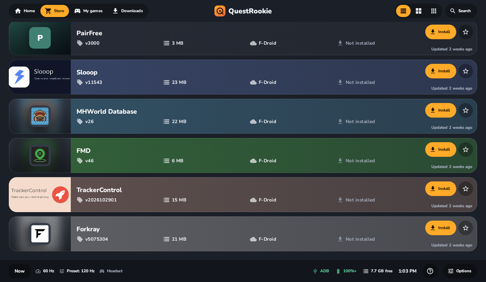
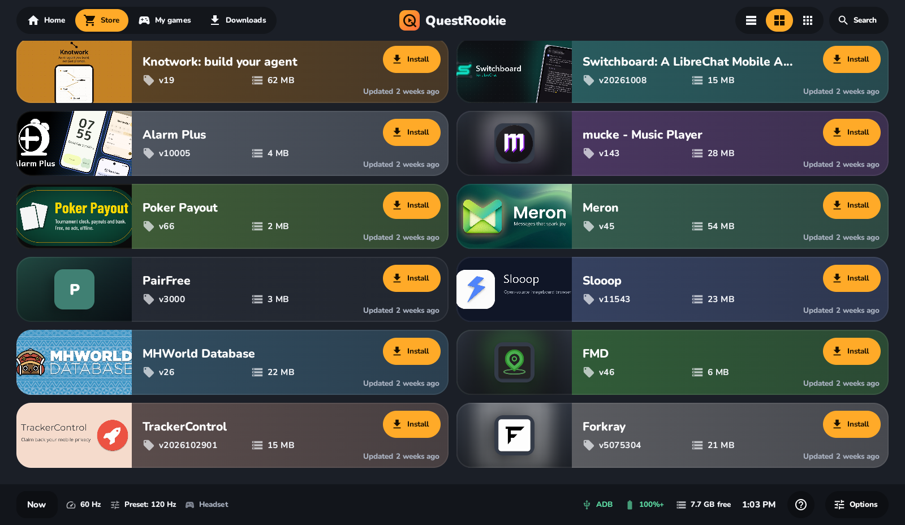
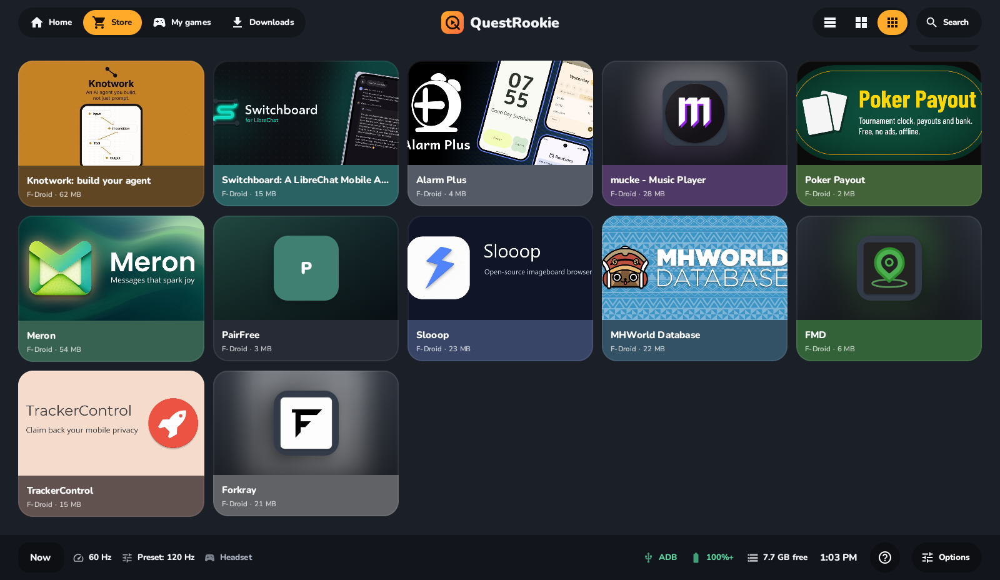
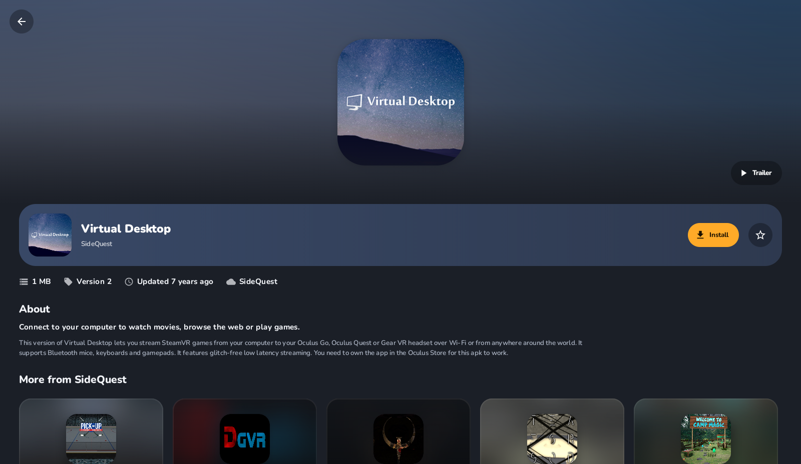
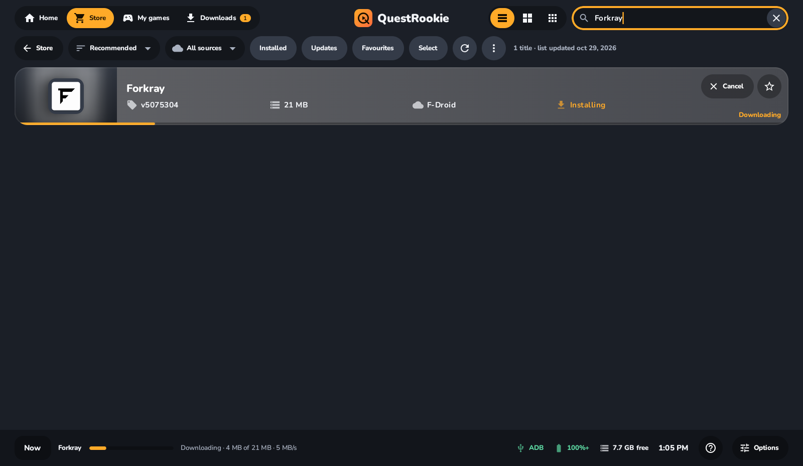
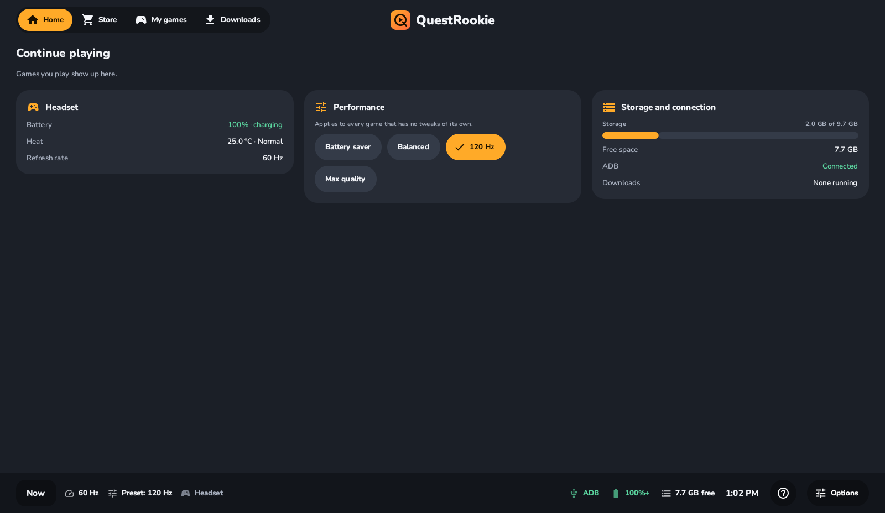
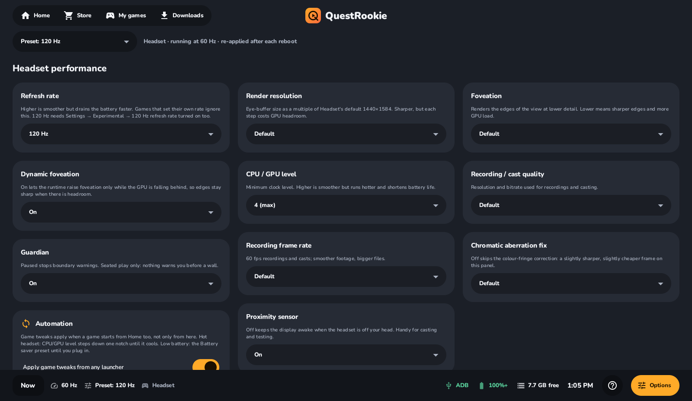

# QuestRookie

A sideloading store, library manager and headset tuner that runs on the Meta Quest itself. Browse several sources, install games and apps (OBB data included) and tune each game's refresh rate, resolution and CPU/GPU level. After a one-time Wireless debugging pairing, it works without a PC.



## Features

### Store
- **Built-in sources:** TheVRSrc, SideQuest (the free SideQuestRepos indexes) and F-Droid.
- **Your own sources:** add Rookie-protocol mirrors and any F-Droid-style repo (an `index-v1.json` link) from **Sources**. A source can be removed again.
- **Store home:** a *New & updated* shelf, then each source's own list.
- **Browse:** search by name or package.
  - Sort by Recommended, Name, Popular, Top rated, Recently updated, Largest or Last played.
  - Filter by source, Installed, Updates or Favourites.
- **Three layouts:** full-width rows, two columns, or an icon grid.
- **Install from a row:** every row has Install / Update / Open and a favourite star.
- **More actions:** select several titles to install at once, *Update all*, and *Surprise me*.
- **Game page:** description, screenshots, what's new, a YouTube trailer and more titles from the same source. Mirror games get their store text from OculusDB.
- **Hide 18+:** titles marked 18+ are hidden by default (Options → Hide 18+).

### Downloads
- **One at a time:** installs run in a queue that survives an app restart. A dropped connection is retried after 15 s, 1 min and 3 min, and the download resumes.
- **Optional rules:** *Wi-Fi only* and *Charging only*.
- **Space check:** an install is refused when free space is below twice the game's size.
- **Install scripts:** a mirror release's `install.txt` is run the way Rookie runs it.
- **Saves:** a game's saves are backed up before it is updated over ADB.
- **Without ADB:** APK-only titles install through Android's own installer, which asks to confirm each one. Games with OBB data need ADB.
- **Always visible:** the bottom bar shows the running download on every page.

### My games
- **Installed:** your sideloaded apps, sorted by name, size, last played or install date, and filtered to games, apps, updates or hidden apps.
  - Each app has Open, Update and favourite buttons.
  - Its menu backs up the APK, OBB and saves to `/sdcard/QuestRookie/Backups/<package>`, disables or enables the app, restores saves, or uninstalls it. Saves are backed up first.
- **Storage:** APK, OBB and save sizes per app. It also lists OBB and save folders left behind by uninstalled apps, with buttons to back up their saves or remove the OBB.
- **Local files:** finds APKs on the headset's storage (split APKs and an OBB folder beside them included) and installs them. It also installs from a pasted APK link.

### Headset tuning
- **Per game:** tap a game to choose its own profile: the global tweaks, a preset, or custom values. The profile is applied each time the game starts.
- **Global tweaks (Options):**
  - refresh rate, render resolution, foveation, dynamic foveation and CPU/GPU level
  - recording/cast quality and frame rate
  - Guardian pause and the proximity sensor
  - chromatic aberration correction (Quest 1 and 2)
- **Presets:** Battery saver, Balanced, 120 Hz (on headsets that support it) and Max quality.
- **Matched to the headset:** options are built for Quest 1, 2, Pro, 3 and 3S. Saved tweaks are re-applied when the app starts after a reboot.
- **Automation (background service):**
  - applies a game's tweaks even when it starts from the Quest home
  - steps the CPU/GPU level down while the headset is hot
  - switches to Battery saver under 20% battery
- **Last session:** frame statistics from a game's last session are shown on its row.

### Headset tools
- Set the player username.
- Run a shell command.
- Turn OS updates off or on.
- Reset the ADB key.
- Reboot the headset.
- **Shortcuts:** a small local web server (port 8765) with a page per app, so the Quest Browser can add sideloaded apps to your library.
- **App size:** Compact, Medium or Standard.

### Controller
- **Y** switches page.
- **B** goes back to the Store.
- The D-pad or thumbstick moves between buttons. The focused one has an orange ring.

## Screenshots

| | |
|---|---|
|  |  |
|  |  |
|  |  |

## Setup on the headset

1. **Turn on developer mode** for the headset in the Meta Horizon phone app.
2. **Install the APK** over USB from a computer:
   ```bash
   adb install -r apk/QuestRookie.apk
   ```
3. **Pair once:** in QuestRookie, press **Connect ADB** (or **?** → **Pair headset**).
   - The pairing dialog opens Android's own Developer options.
   - Turn on **Wireless debugging** and choose **Pair device with pairing code**.
   - Enter the port and the 6-digit code.

   From then on, QuestRookie connects to the headset's own ADB (`127.0.0.1:5555`) without a PC.
4. **Optional mirror:** the primary Rookie mirror is read from `Android/data/com.questrookie/files/config.json`. The file holds `baseUri`, a base64 `password`, and optionally `fallbacks` and `apiKey`. Extra mirrors and repos are added in the app under **Sources**.

Usage access (for *Last played* and Automation) and storage access (for *Local files*) can be granted over ADB from the app.

## Building

Needs JDK 17 and the Android SDK (compile SDK 35). The app targets Android 10 (API 29) and up.

```bash
git clone https://github.com/EillotBappo/QuestRookie.git
cd QuestRookie
./gradlew assembleRelease        # or ./build_questrookie.sh
adb install -r app/build/outputs/apk/release/app-release.apk
```

Use the release build: debug builds run Compose interpreted and stall the UI. The release build is signed with the debug key, so it installs over a debug install.

Run the unit tests with:

```bash
./gradlew testReleaseUnitTest
```

## Project structure

- `app/src/main/java/com/questrookie/`
  - `Ui.kt`: theme and shared components
  - `MainActivity.kt`: app shell, header, bottom bar, pairing
  - `Library.kt`: Store
  - `Device.kt`, `Storage.kt`: My games
  - `Queue.kt`: Downloads
  - `Tweaks.kt`, `Headset.kt`: tweaks and Options
  - `Catalogs.kt`, `Rookie.kt`: sources
  - `Installer.kt`, `WirelessAdb.kt`, `PackageInstall.kt`: installing
  - `Automation.kt`, `Shortcuts.kt`
- `app/src/test/`: unit tests
- `apk/QuestRookie.apk`: prebuilt release APK
- `docs/`: design notes and screenshots

QuestRookie is not affiliated with Meta.
